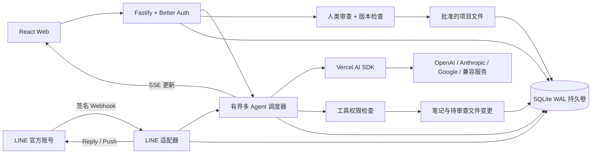

# 已实现架构、权限与执行流程

AI SDK 负责模型协议、流式与工具循环；Better Auth 负责密码/会话；官方 LINE SDK 负责签名/消息；Radix 负责对话框；React Markdown 负责安全呈现。自建部分是群成员、调度、权限、项目审查与双端绑定，选型见开源调研。

当前单 Node 进程 + 单 SQLite 持久卷，最多 12 个活跃群任务、每群一次任务、每任务最多 3 模型并发。**不可直接横向加副本**，内存任务控制器和事件通知需先迁移。

## 执行流程

1. Web 校验会话、空间成员、群可见性、写权限、输入；LINE 校验签名、事件去重、绑定与启用状态。
2. 根据启用伙伴、@、指定对象和模式选择模型，校验模型属于配置服务。
3. 原子预留最多模型步骤，保存任务与用户消息。本次问题优先保留、每位有效前轮发言分配预算，剩余空间再读最近 50 条旧有效消息。上下文含 JSON 包装与轮次任务不超过 48,000 字符，不读别群。自己的历史回答使用 assistant 角色。
4. 调度独立回答，持久化流式内容和轮次；至少两份第一轮有效回答才做第二轮，失败者不再调用。单人讨论降为单轮并解释。个别失败不抹去其他结果。
5. 启动时按每位每轮无工具一步、有工具最多三步原子预留；每个 SDK 步骤实际消耗预留并计数。工具后续请求也计数。结束、取消或重启释放未用额度，失败已用不退款。归属任务开始的 UTC 日期，不是精确费用账单。LINE 单独限额且受总上限约束。
6. 每次工具重新核对群状态、成员/LINE 绑定、伙伴开关和取消状态。取消后禁止写入。
7. 保存结果/token/状态。重启后标记运行中任务为中断，不自动重新收费执行。

协议支持 OpenAI-compatible Chat Completions、OpenAI Chat、Anthropic Messages、Google Generative Language。CanalAPI 为默认服务；每个模型的工具能力和可用性仍由服务商决定。

## 权限

| 操作 | 所有者/管理员 | 成员 | 只读 |
| --- | --- | --- | --- |
| 读取有权访问的群 | 是 | 是 | 是 |
| 新建群、聊天、笔记、提案 | 是 | 是 | 否 |
| 改群/伙伴、归档、LINE绑定、批准项目 | 有权访问的群 | 自己创建的群 | 否 |
| 配置服务、邀请、审计 | 是 | 否 | 否 |
| 读取别人私有群 | 否 | 否 | 否 |

所有者控制高权限角色变更，管理员权限受限。每个接口独立校验，隐藏按钮不是授权。LINE 身份只拥有已绑定群的聊天及已启用有限工具，不能继承网页管理员身份。

## 工具和安全审查

| 工具 | 范围 | 写入 |
| --- | --- | --- |
| current_time | 当前时间 | 无 |
| read_room_notes | 本群有限条数笔记 | 无 |
| save_draft | 本群，最多每伙伴每轮三份 | 草稿 |
| read_project | 共享项目或自己的分支 | 无 |
| propose_project_changes | 本群分支，限定路径/体积 | 待审查提案 |

批准前检查角色、群、提案状态、全部文件版本，再原子提交。审批不会执行代码。目前没有任意 shell、动态 MCP 插件、GitHub 写入或部署工具。

后续外部工具须走服务端授权：区分读取、草稿、外发、破坏性操作；外发/部署批准绑定具体参数摘要，一次性消费；使用独立执行环境和最小权限凭据。系统提示词不能替代这些控制。

数据库含空间/成员、群/消息/任务、笔记、项目版本/提案、服务配置、邀请、LINE事件/发信状态、用量和审计。API 与 LINE 密钥 AES-256-GCM 加密；聊天正文没有字段加密。

公共版路线：Postgres、持久队列与租约、跨进程通知、租户和账单、验证与恢复、滥用防护、数据删除/保留政策、备份告警。企业版再扩展 SSO、部门权限、知识检索、业务审批。自动开发执行须接隔离容器，不能把应用服务器当作 Agent 电脑。

LINE 绑定记录独立默认模式、资料工具开关、消息序号边界和唯一 scope。只读本次绑定后的 LINE 来源消息，默认不提供资料工具；开启后可读取本群全部笔记／项目。共享开关变化会换 scope 并重置上下文；排队事件、每步工具和发送前校验同一 scope，阻止旧任务跨解绑／重新绑定继续执行。回传按显式 round 选择最后轮次完整消息，系统说明与 Agent 正文分开。
