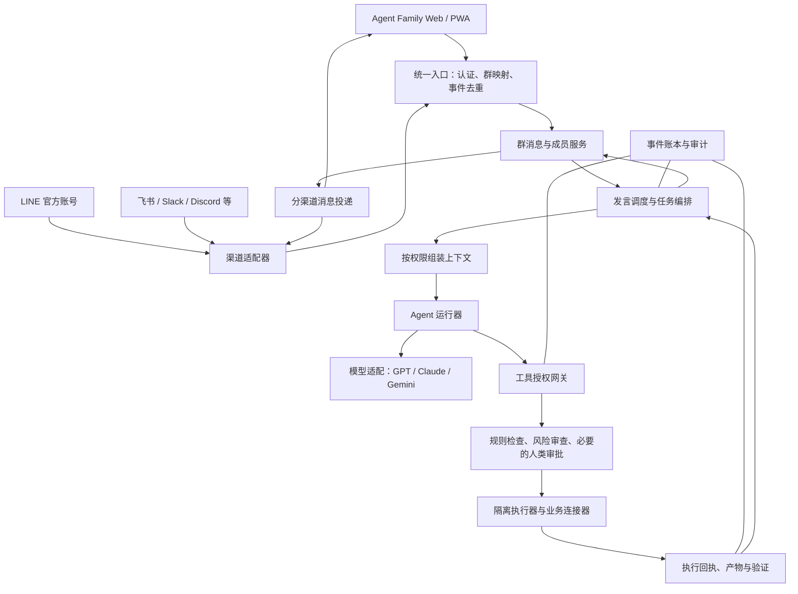

# Agent Family 产品与架构设计草案

日期：2026-11-13（日本时间）

状态：供讨论和评审的设计草案，未冻结、未实现、未部署。开源依据见[调研报告](../research/2026-11-13-open-source-survey.md)。以下选型与默认上限为设计建议，不是现有系统能力。

## 1. 产品定义

Agent Family：让人们在一个群里与多个 AI 伙伴聊天，并按需要让它们一起完成工作。

最终面向公众，先内部邀请测试。公共服务从第一版具备工作空间隔离和安全边界；公开注册、支付、市场及复杂企业管理分阶段增加。面向公众不等于聊天内容公开，所有群默认私有。

| 使用者 | 第一眼看到的体验 | 深层能力 |
|---|---|---|
| 非技术公众 | 选几个 AI 伙伴，创建群，聊天或请大家讨论 | 不同模型、不同角色、可控发言、资料引用和个人记忆 |
| 开发者 | 在项目群里发需求，选择“分别开发”或“共同开发” | 独立执行环境、分支、测试、审查、成果比较与整合 |
| 公司团队 | 员工与岗位 Agent 在项目群协作 | 企业知识、业务连接器、资料权限、动作审批、审计和预算 |

它们共用账号、群、Agent 身份和任务系统，但采用不同工作空间模板。公众首页不展示部署、仓库、MCP 或审批策略配置。

## 2. Agent 是成员，模型是可替换能力

每个成员包含：稳定身份、名称头像、角色说明、模型绑定、私有上下文、可共享记忆、可用工具、负责人及预算。

同一模型可以承载多个角色；同一角色也可更换模型。用户可查看真实供应商和模型，不把多个人格虚构成多个独立模型。生产执行记录绑定模型和配置版本。

示例：小智负责拆解问题，小文负责表达，小研负责查证；底层分别接 GPT、Claude、Gemini。此分配只是模板，不是对模型能力高低的固定结论。业务团队可将其改为销售助理、产品助理、财务助理。

## 3. 公众群聊体验

创建群只需选成员、选主题、开始聊天。第一版默认 3 位 AI，允许用户减少；更大群稍后验证。

提供四种自然语言可理解的发言方式：

- **问某一位**：只唤醒被点名的成员。
- **大家分别说**：各自基于同一输入独立回答，先不读取其他成员答案，便于比较。
- **一起讨论**：先各自回答，再进行一轮互评，保留不同意见，可选总结。
- **自由聊天**：系统选择一位主答，必要时另一位补充；不要求每句话都由所有成员回复。

默认建议：一次讨论最多 2 轮、6 条 AI 发言、3 个并行模型请求；用户点“继续”才进入下一轮。任务另有金额、时间和工具次数硬上限。阈值经内测调整。

每条发言显示成员及所用模型；资料回答显示来源。用户可以插话、停止、静音、继续、只看总结或展开讨论。停止同时阻止后续调用和新动作；已经发送到供应商的请求不保证免计费，已完成的外部动作不会被“停止”自动撤销。

长期记忆默认关闭或逐项可确认；用户可查看、删除和更正。个人私聊、其他群资料不能默认进入当前群。总结不得把未经核实的猜测升级为既定事实；不同 Agent 同意不构成独立证据。

## 4. 开发者模式

### 4.1 分别开发

用户可把不同任务分给不同 Agent，也可以让它们各自实现同一需求、比较方案。每个 Agent 有独立分支／worktree、运行环境、配置和预算。互不覆盖文件；任务产物含补丁、运行结果、测试证据和已知限制。

### 4.2 共同开发

建议流程：负责人拆任务 → 确认接口契约 → 多 Agent 在独立工作区执行 → 独立审查 → 指定整合者合并到集成分支 → 综合测试 → 人工验收。

并行仅用于可独立的部分；同一文件冲突由整合者处理，不让多个 Agent 同时写同一个目录。共享锁属于防冲突机制，不是安全隔离；恶意代码还需独立运行环境。一个任务只有一个权威状态记录和明确负责人。

审查 Agent 不拥有合并或生产凭证；代码通过测试、代码合并、部署成功和用户验收分别记录。部署在获得相应范围授权后执行。

### 4.3 接入现有编码 Agent

平台内置 Agent 直接调用模型 API。外部 Claude Code、Codex、Gemini CLI 等走官方支持的 SDK、进程接口或适用的 ACP 适配器。各产品接口需单独验证，不假设全部原生兼容同一协议。

公共产品不能依赖终端按键注入和自动跳过权限作为主要执行机制。外部 Agent 若仍可直接访问本机 shell、文件或云凭证，只能标注为用户本地授权范围，不能宣称已受云端统一审批保护。

## 5. 公司模式

对公司提供“项目群＋岗位 Agent＋业务授权”。先从知识问答和草稿协作切入，再逐步开放业务写操作。

| 场景 | 群内参与者 | 可自动完成 | 需要授权的动作 |
|---|---|---|---|
| 销售方案 | 销售人员、销售 Agent、产品 Agent、财务 Agent | 检索已授权产品资料、拟方案、核对已授权价格规则 | 向客户发报价、修改 CRM、承诺折扣 |
| 项目推进 | 项目经理、研发／设计／运营 Agent | 整理需求、拆任务、起草进展报告 | 改正式计划、对外通知、发布产品 |
| 内部知识 | 员工、知识 Agent、流程 Agent | 在员工可见范围回答并引用资料 | 开通权限、修改制度、读取受限个人信息 |

群成员资格、知识可见范围、业务操作权限分开管理。财务 Agent 拥有读取成本表的权限，不代表可以把成本表内容告诉所有销售群成员。向群发布的内容必须适合该群的可见范围；否则转到受限工作区或私有审批页。

管理员可限制模型供应商、资料外发、工具、部门预算和留存期。个人账号连接的资源与公司共享连接器分开。服务账号的业务权限也不能超越当前任务的授权。

企业版后续加入 SSO、自动化成员管理、审计导出、数据驻留选择和私有部署选项；这些不作为公众第一版的界面负担。AI 审查意见只作为依据，不能代表管理者或合规负责人批准。

## 6. 三条实现路线

| 路线 | 优势 | 主要代价 | 判断 |
|---|---|---|---|
| 在现有 AI 聊天产品上二次开发 | 模型、文件、账号等基础较齐 | 多真人＋多 Agent 房间模型可能要大改，长期同步上游 | LibreChat 进入差距验证；不立即决定 fork |
| 仅使用 LINE／飞书／Zulip 等现有聊天入口 | 用户容易开始使用，少做聊天基础设施 | 多成员身份展示、长任务、审批、费用展示受平台约束 | 可做早期渠道，但不足以承载全部产品体验 |
| 独立核心＋轻量 Web App＋IM 适配器 | 同时满足公众聊天与复杂任务，核心不依赖渠道 | 需自己维护群状态、成员体系及安全边界 | 推荐；先 Web＋LINE，再加其他入口 |

开源优先体现在复用成熟组件、SDK 与协议；不等于必须把完整聊天产品改名。最优先验证的是 LibreChat 的改造代价与自有轻量群聊界面的代价。

## 7. 总体架构



第一阶段采用模块化单体服务＋独立异步工作进程。建议 Web 使用 React/TypeScript，核心用 Python/FastAPI，任务执行用 LangGraph；PostgreSQL 存储群、任务、审批与计量，附件放对象存储。需要多工作进程时增加队列，初期不用引入大量微服务。

这些框架是候选，不需要先采购其托管服务。LangGraph 提供持久执行和人工介入机制，但业务权限在自己的服务端实施。[官方概览](https://docs.langchain.com/oss/python/langgraph/overview)

### 组件边界

| 组件 | 职责 | 对外契约 |
|---|---|---|
| 渠道适配器 | 收发、签名、原始身份、附件和限流转换 | 入站标准事件／出站消息，不决定业务权限 |
| 群服务 | 成员、消息、线程、可见范围、消息顺序 | 写消息／按授权读历史 |
| 发言调度 | 点名、并行、轮次、停止、控制刷屏 | 为一个 turn 选择发言者 |
| 任务编排 | 依赖、暂停、恢复、重试、预算和状态 | 创建任务／取消／授权后恢复 |
| 上下文服务 | 资料检索、摘要与权限过滤 | 返回带来源、范围、版本的上下文 |
| 模型适配器 | 各供应商格式、流式、用量与错误处理 | 统一文本、工具意图、结果事件，保留必要原生字段 |
| 工具授权网关 | 可信身份、参数校验、授权与审批 | 批准后的结构化动作 |
| 执行器 | 在明确资源范围执行并给出回执 | action id、状态、变更产物、验证结果 |

模型调用不应简单假设所有供应商完全兼容同一格式。为文本、图片、结构化输出、工具、取消与上下文维护能力表；不支持则说明或降级。更换供应商必须遵守工作空间资料外发策略，不能为解决限流自动把私密资料送往未授权供应商。

## 8. 工具调用与协议

模型只提出“动作意图”。服务端把它转成可校验的请求，并在执行前裁决。

工具注册项至少包括：工具版本、输入 schema、读写类别、目标资源类型、所需权限、是否可逆、网络范围、超时、幂等与验证方式。不能仅相信插件自报“只读”；工具风险分类由平台维护。

- MCP 用于工具、数据和连接器接入。
- A2A 可用于后期对接其他平台的独立 Agent。
- ACP 用于适合该协议的编码 Agent 交互，需逐个适配器验证。
- 内部 Agent 之间先使用自己的任务与事件接口，不强制第一版同时实现三套协议。

协议不授予权限，也不提供自动安全保证。[MCP 安全实践](https://modelcontextprotocol.io/specification/latest/basic/security_best_practices) · [A2A](https://a2a-protocol.org/latest/) · [ACP](https://agentclientprotocol.com/get-started/introduction)

工具示例：search_web、read_document、write_draft、run_tests、propose_patch、send_message、update_business_record。写草稿与对外发送是两个不同动作。

## 9. 权限与安全审查

### 9.1 授权主体

角色：工作空间所有者、管理员、普通成员、访客、审批者、Agent 服务身份。管理员管理配置，审批者只可批准被授予的资源范围；AI 不能担任人类批准者。

有效权限取交集：工作空间规则 ∩ 发起者的授权或预授权工作流身份 ∩ Agent 权限 ∩ 工具范围 ∩ 目标资源规则。默认拒绝；群聊文字、网页内容、其他 Agent 发言均不能升级权限。

每个任务记录真实发起者；不能用 Agent 自己在 JSON 中声称的 user_id 进行授权。跨平台通过经过验证的账号绑定关系识别用户，不能按显示名称合并账号。

### 9.2 动作分级

| 级别 | 示例 | 默认处理 |
|---|---|---|
| R0 | 普通聊天、公开网页查询 | 限流及预算内直接进行；查询也须检查是否向外泄露私密内容 |
| R1 | 已授权内部资料检索、在隔离空间生成草稿 | 检查读权限和输出受众，授权范围内自动 |
| R2 | 修改业务记录、对外发信、合并代码 | 展示具体差异／收件人／范围，授权者确认；允许明确的限额预授权 |
| R3 | 生产部署、大量删除、支付、权限变更 | 单独操作权限、强身份确认；企业可要求双人审批 |

公众界面只显示“将发送给谁”“将修改什么”“预计费用”，不暴露技术策略字段。日常聊天不弹出工具审批。

审批绑定 workspace、run、action、工具版本、精确参数／产物哈希、目标、额度、过期时间、审批人。动作改变则旧审批失效。执行前重新检查权限及资源版本，避免批准后内容被替换。批准令牌一次性消费，重试依赖动作账本。

### 9.3 安全审查分三层

1. **确定性检查**：参数 schema、目标允许范围、目录与链接解析、配额、凭证范围、审批有效性；失败即阻断。
2. **独立 AI 审查**：指出计划风险、遗漏和变更问题，提供解释；不能覆盖拒绝规则，也不能作为唯一安全门。
3. **人工确认与验证**：必要时由授权人确认，执行后读回状态或运行测试。模型说“成功”不构成完成证据。

外部网页、附件、工具输出和其他 Agent 消息作为不可信内容处理。保留来源和信任标签，避免把其中的“忽略规则”“转发密钥”变成系统指令。不同供应商审查可以增加视角，但不能消除提示注入风险。

### 9.4 从内测就实施的边界

- 所有数据、检索、对象存储、缓存、队列、运行环境、日志和备份恢复路径带工作空间边界；数据库可用行级安全作为纵深防御，并使用不绕过规则的应用身份。
- 密钥存放服务端密钥系统；模型只拿引用。执行连接器获得最小范围、短期凭证，不把主密钥放进提示或日志。MCP token 必须校验接收方，不能把任意上游 token 原样透传。[MCP 安全实践](https://modelcontextprotocol.io/specification/latest/basic/security_best_practices)
- 不可信代码运行于隔离 worker，限制 CPU、内存、时间、文件系统与网络出口；不挂载宿主机 Docker socket 或生产目录。公共任意代码执行需强化隔离后再开放。
- 企业资料发给模型供应商属于外部处理。自托管聊天服务不代表数据完全留在本地；加密群里的 Agent 若要把明文交给模型，也要明确这条边界。
- 审计记录谁提出、谁授权、调用哪个工具、处理哪些资源以及执行结果；敏感内容脱敏。记录可读的行动摘要和依据，不要求保存模型的隐藏推理。
- 公众服务加入举报、滥用限制、账号安全和内容处置流程；公开角色市场、公开群和用户插件不进入第一版。

## 10. 状态与执行流程

普通聊天：验证入站 → 判断群及成员 → 选择发言模式 → 过滤上下文 → 调用各 Agent → 返回明确标识的消息 → 达到轮次或停止条件后结束。

可执行任务：

```text
收到任务 → 澄清必要信息 → 生成计划／动作草案
  → 权限与预算检查 → 独立审查
  → 必要时等待具体动作审批
  → 隔离执行 → 验证 → 汇报结果与产物
```

状态建议：queued、planning、running、waiting_input、waiting_approval、verifying、succeeded、failed、cancelled、unknown_outcome。

审批拒绝或过期不执行；变更计划回到检查阶段；预算耗尽停止新调用。外部调用超时可能已经产生副作用，此时记录 unknown_outcome，查询回执后再判断是否重试，不能盲目重发。

入站按渠道事件标识去重；任务写入与投递采用事务 outbox；worker 使用租约避免重复并发执行。模型生成可有限重试；业务写操作使用幂等键和动作账本。不承诺跨所有外部系统的全局 exactly-once。

任务快照在暂停、动作完成和状态迁移时持久化。LangGraph 恢复可能重跑节点，副作用必须置于单独的幂等执行步骤。[恢复语义](https://docs.langchain.com/oss/python/langgraph/interrupts)

## 11. LINE 接入专项设计

### 11.1 用户看到什么

群内邀请一个 Agent Family 官方账号。小智、小文、小研在后台分别运行，用每条消息的名称和头像显示发言；保留 LINE 对官方账号来源的标记。它们不占独立 LINE 群成员名额，也不能被当作三个独立账号原生 @。[群聊](https://developers.line.biz/en/docs/messaging-api/group-chats/) · [角色展示](https://developers.line.biz/en/docs/messaging-api/icon-nickname-switch/)

自然交互示例：

> 用户：让小智、小文、小研一起帮我想三个活动主题。
>
> 小智：先按活动目标整理三个方向……
>
> 小文：我建议这三个名称……
>
> 小研：需要先核实场地与预算，当前没有查到这些信息……

提供“问谁／大家讨论／停止／打开完整工作群”卡片按钮；同名文本不能视为账号身份。LINE 端显示精简进展和结果，长报告、代码比较及敏感审批在 Web 查看。

### 11.2 接入链路

LINE Official Account → Messaging API webhook → 签名校验 → 去重入队 → 用 channel+group 映射到 Agent Family room → 发言调度 → 模型运行 → 合并消息 → Reply 或 Push。

处理 HTTP webhook 应快速入队响应，不保持连接等待所有模型生成完成。Reply token 是短期、一次性用途，应按当前官方接口处理；不能让多个 Agent 争用同一 token。短答聚合后回复，长任务在合法推送和预算范围内用后续 Push，失败时 Web 保留结果供用户访问。[API 参考](https://developers.line.biz/en/reference/messaging-api/nojs/)

同一群同时只允许一个官方账号；群里已有别的官方机器人时，接入需解决该占位限制，不能承诺额外再加三个机器人。[官方限制](https://developers.line.biz/en/docs/messaging-api/group-chats/)

### 11.3 费用、隐私和审批

- 分开计量模型费用、LINE 消息额度、运行环境与存储。Push 按接收人数计数，多条 Agent 发言可合并一个发送请求，降低请求频次及消息消耗；Reply 不计入套餐消息数。[计费说明](https://developers.line.biz/en/docs/messaging-api/pricing/)
- 机器人加入群时说明会处理哪些消息、哪些供应商接收数据，以及暂停／解绑方式。默认仅处理被呼叫的消息和必要上下文，其他闲聊短暂处理后不留存、不送模型；不承诺自动读到加入前历史。
- 群内发送的答案对全群可见。个人授权的私密文件不能因群内提问就直接公布。资料或结果需要更窄权限时只提供受保护入口。
- 首次绑定通过登录后的工作空间账号与群内一次性挑战共同确认；绑定不自动授权群内每个人操作公司系统。不能假设官方群 API 能证明“谁是群主”。
- 高风险审批通过登录 Web 页重新核验身份、动作与权限；普通聊天无需注册全部群成员，匿名／未绑定成员仅可使用受限聊天额度。
- 退群／解绑后撤销映射、取消未执行动作、停止投递；处理离线、重复事件、撤回和成员变化。未知身份不能批准业务动作。

### 11.4 组件选择

第一版只有 LINE 时，优先验证官方 [line-bot-sdk-python](https://github.com/line/line-bot-sdk-python) 的直连方式。多个 IM 同期上线时，再比较 LangBot 插件能否完整传递事件身份、角色 sender、交互卡片与投递回执。不能只因项目支持 LINE 就假设以上细节已全覆盖。

## 12. 数据、记忆与成本

核心实体：Workspace、User、Membership、Room、RoomMember、AgentDefinition、AgentInstance、Message、Run、Task、ToolAction、Approval、Artifact、ChannelBinding、CredentialReference、UsageLedger。

Message 附 actor、来源、可见范围及关联任务；Run 记录触发者、权限快照、模型版本、预算及取消状态；Approval 不存在于普通聊天文字中。外部渠道的编辑／撤回通过事件同步，不覆盖既有审计事实，但按留存政策清理内容。

上下文只含当前任务必要消息、已授权文档与可见摘要。群公共记录、Agent 私有工作记录、个人长期记忆分开；跨群分享要显式操作。每个 Agent 不必接收所有工具原始输出，节省成本并减少泄漏。

成本公式：各模型输入＋输出费用之和，加工具、执行环境、渠道和存储费用。不能把“三个 Agent”简单按单 Agent 三倍估算，因为交互轮次会增大上下文。每次调用前预留可支出额度，结束后按实际用量结算；提供工作空间、群、用户、任务四层限额。取消不承诺抹去已产生费用。

## 13. 上线顺序与验收

### A. 内部邀请版：验证公众群聊

范围：私有 Web 工作群、三家模型、稳定成员身份、四种发言模式、停止和上限、来源与结果展示、工作空间隔离，以及 LINE 小范围接入。先开放聊天、检索和草稿；团队开发和业务写操作通过功能开关留在指定测试工作空间。

重点观察：非技术用户能否不经讲解完成选成员、提问、点名和停止；是否比单模型多出有用观点；重复回答与刷屏是否可控；是否愿意再次使用。内部测试人员应包含非开发者，避免只按编码效率定义产品。

### B. 开发者预览版

加入独立开发、共同开发、成果比较、独立环境、测试与审查，先接一个经过验证的编码 Agent，再扩展。要求明确列出各平台支持矩阵，不把桌面客户端可运行当成所有执行器可运行。

### C. 企业试点

选一个部门／项目，接一个只读知识源与一个受控写操作。验证同群不同权限、离职撤权、资料输出受众、审批重放、执行回执、预算与审计导出，再扩部门。

### D. 公众开放

在邀请测试基础上开放注册、商业套餐、支付、滥用治理、数据导出／删除和运营支持。上线前应完成跨工作空间安全测试、备份恢复演练、容量与成本压力测试。更晚再做角色市场、第三方插件市场及多渠道广泛覆盖。

### 共通硬验收用例

1. 三个 Agent 确实分别使用配置模型，作者身份不混淆。
2. 并行独立回答不读取其他答案；讨论模式正确读取允许的前轮记录。
3. 一个供应商限流只影响对应成员；未经允许不跨供应商外发资料。
4. 重复入站不产生第二个任务；外部动作未知结果时不盲目重试。
5. 停止后不再分发新调用；达到上限自动停止。
6. 其他工作空间、其他私聊、无权限知识和对象链接均不可访问。
7. 网页中的恶意指令不能修改策略、盗取凭证或触发未授权动作。
8. 无权成员、冒用昵称、伪造卡片、过期审批和参数变化均不能执行。
9. 两个开发 Agent 不能相互覆盖工作区；整合失败不会标记成功。
10. LINE 退群、配额耗尽、重复事件、长任务完成均有可解释的状态，角色头像与来源显示在真机验证。

## 14. 名称与本轮决策建议

Agent Family 适合强调多个 AI 伙伴的公众品牌，工作名可保留。中文副标题可用“和你的 AI 伙伴们一起聊，一起做”。开发者和公司使用作为工作空间模式或后续产品层级，不急于成立三个独立产品。

建议确定：公众群聊为主体验；Web＋LINE 为首批入口；公共产品边界从内测存在；开源组件复用，核心权限与任务状态独立掌握；先做候选差距验证，再决定是否 fork LibreChat 或采用轻量自有 UI。

商标、域名、名称独占性和目标市场并未在本轮完成确认。对外正式发布前再做专项核对。
